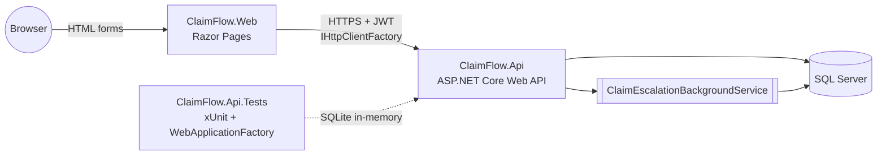

# ClaimFlow


An insurance claims processing platform built as two independent ASP.NET Core 8
services: a **Web API** that owns the business rules and data, and a **Razor
Pages** client for claims staff. Built to demonstrate a realistic backend slice
of an insurance product — adjudication math, a multi-step approval workflow,
and the kind of concurrency bugs that only show up once two adjusters click
the same button at the same time.

## What it solves

Someone files an auto/home/health/life insurance claim against a policy. An
adjuster reviews it, the system calculates what's actually payable after the
deductible and the policy's remaining coverage, and — if the payout is large
enough — a supervisor has to sign off before it can be paid. ClaimFlow models
that lifecycle end to end: intake, adjudication, multi-level approval, payment,
and an automatic SLA monitor that flags claims nobody has touched in too long.

## Business rules

- **Coverage window** — a claim can only be filed against an `Active` policy,
  and the incident date must fall between the policy's effective and expiry
  dates. Otherwise the API returns `409 Conflict`.
- **Deductible & coverage-limit adjudication** — on approval, the payable
  amount is `min(claimedAmount - deductible, remainingCoverage)`, where
  `remainingCoverage` is the policy's limit minus everything already approved
  or paid on that policy. A claim that doesn't clear the deductible, or a
  policy with no coverage left, is auto-rejected instead of approved.
- **Multi-level approval** — if the payable amount exceeds a configurable
  threshold (`ClaimRules:SupervisorApprovalThreshold`, default $5,000), the
  claim moves to `PendingSupervisorApproval` instead of `Approved`, and only a
  Supervisor (or Admin) can finalize it.
- **Claim state machine** — `Submitted → UnderReview → (PendingSupervisorApproval →) Approved → Paid → Closed`,
  with a `Rejected` branch from `UnderReview` or `PendingSupervisorApproval`.
  Every transition is guarded on the `Claim` entity itself; an illegal jump
  throws a domain exception mapped to `409 Conflict`.
- **Optimistic concurrency** — claims carry an application-managed integer
  `Version` concurrency token (not a provider-specific `rowversion`), so the
  same guarantee holds on SQL Server in production and SQLite in tests. If two
  adjusters try to claim the same case, one wins and the other gets a `409`
  after a bounded retry.
- **SLA escalation** — a `BackgroundService` periodically flags claims stuck in
  review past `ClaimRules:ReviewSlaHours` (default 72h) so they surface on the
  dashboard.
- **Audit trail** — every status change is recorded with who changed it, when,
  and why, exposed via `GET /api/claims/{id}/history`.

## Architecture



Two deployable services, one shared contract (HTTP + JSON):

- **ClaimFlow.Api** — ASP.NET Core Web API, EF Core, SQL Server. Owns every
  business rule, the JWT issuer, and the escalation worker.
- **ClaimFlow.Web** — ASP.NET Core Razor Pages. No direct database access; it
  talks to the API exclusively through a typed `HttpClient` and keeps the
  user's JWT inside a cookie-based `ClaimsPrincipal` (not in local storage or
  a server-side session store).

## Technical decisions

- **Integer `Version` instead of `rowversion`/`byte[]`.** SQL Server's
  `rowversion` has no SQLite equivalent, and the test requirement is "SQLite
  in tests, SQL Server in production." `Claim` and `Policy` implement
  `IHasConcurrencyVersion`; `ClaimFlowDbContext` increments `Version` on every
  update and EF Core treats it as a concurrency token — identical behavior on
  both providers, no provider-specific SQL.
- **Client-side aggregation for the adjudication sum.** SQLite's EF Core
  provider can't translate `Sum()` over a `decimal` column into SQL. The
  "already paid for this policy" lookup in `ClaimsService.ApproveAsync` pulls
  the (small) candidate set and sums in memory instead, so the same code path
  runs unchanged against SQL Server and SQLite.
- **Two-phase claim numbering.** The friendly `CLM-000123` number is derived
  from the database-generated `Id`, which doesn't exist until after the first
  insert. `Claim.File()` stamps a temporary unique placeholder so the `NOT
  NULL` column is satisfied on insert; `ClaimsService` immediately rewrites it
  to the final format in a second `SaveChanges` call.
- **`Claim` vs `System.Security.Claims.Claim`.** The domain name collides with
  .NET's own claims-based identity types. Files that need both import only one
  unqualified and alias the other (e.g. `ApplicationUser` for
  `Domain.Entities.User` inside `JwtTokenService`) rather than fully
  qualifying every reference.
- **PBKDF2 over ASP.NET Core Identity.** A handful of fixed roles (Admin,
  Adjuster, Supervisor) didn't justify pulling in the full Identity stack;
  `PasswordHasher` does PBKDF2-HMAC-SHA256 with a random salt per user, and
  `JwtTokenService` issues the bearer token.

## Endpoints

| Method | Route | Auth | Description |
|---|---|---|---|
| POST | `/api/auth/login` | Rate-limited, anonymous | Authenticate and receive a JWT |
| GET | `/api/policies` | Any authenticated role | Paginated policy list, filterable by status |
| GET | `/api/policies/{id}` | Any authenticated role | Policy detail |
| POST | `/api/policies` | Admin | Create a policy |
| GET | `/api/claims` | Any authenticated role | Paginated claim list, filterable by status/policy |
| GET | `/api/claims/{id}` | Any authenticated role | Claim detail |
| GET | `/api/claims/{id}/history` | Any authenticated role | Status-change audit trail |
| POST | `/api/claims` | Any authenticated role | File a new claim against a policy |
| POST | `/api/claims/{id}/assign` | Adjuster, Admin | Assign the claim to yourself (optimistic concurrency) |
| POST | `/api/claims/{id}/approve` | Adjuster, Admin | Run adjudication; approves, escalates to supervisor, or auto-rejects |
| POST | `/api/claims/{id}/reject` | Adjuster, Supervisor, Admin | Reject with a reason |
| POST | `/api/claims/{id}/supervisor-decision` | Supervisor, Admin | Finalize a claim pending supervisor approval |
| POST | `/api/claims/{id}/mark-paid` | Admin | Mark an approved claim as paid |

Full request/response schemas are in Swagger UI (`/swagger`) when the API runs
in Development.

## Running it

### Option 1 — Docker Compose (full stack)

```bash
docker compose up --build
```

- API: `http://localhost:8080` (Swagger at `/swagger` in Development)
- Web: `http://localhost:8081`
- SQL Server: `localhost:1433` (sa / `ClaimFlow_Sql123!`)

### Option 2 — `dotnet run` (no Docker)

Start a local SQL Server however you like (or just `docker compose up sqlserver`),
then run both projects — `ClaimFlow.Web`'s `appsettings.json` already points
`Api:BaseUrl` at the API's `dotnet run` port (`http://localhost:5252`), so
nothing else needs configuring:

```bash
dotnet run --project src/ClaimFlow.Api
dotnet run --project src/ClaimFlow.Web
```

The API applies EF Core migrations and seeds demo data automatically on
startup (skipped only when `ASPNETCORE_ENVIRONMENT=Testing`).

### Demo accounts

Seeded automatically on first run:

| Role | Email | Password |
|---|---|---|
| Admin | `admin@claimflow.dev` | `Admin#12345` |
| Adjuster | `adjuster@claimflow.dev` | `Adjuster#12345` |
| Supervisor | `supervisor@claimflow.dev` | `Supervisor#12345` |

Two demo policies (`POL-AUTO-0001`, `POL-HOME-0001`) are seeded as well so you
can file a claim immediately.

## Testing

```bash
dotnet test
```

40 xUnit tests, no external services required:

- **Domain unit tests** — the `Claim` state machine and the deductible /
  coverage-limit adjudication math, in isolation.
- **Integration tests** — `WebApplicationFactory<Program>` against an
  in-memory SQLite database, exercising the real HTTP pipeline (auth,
  controllers, middleware): full claim lifecycle, auto-rejection, multi-level
  approval, validation errors, 404/409 mapping.
- **Concurrency tests** — two simultaneous assign requests against the same
  claim, asserting exactly one succeeds.
- **Background worker tests** — the SLA escalation sweep against a seeded
  SQLite database.

## Project layout

```
src/
  ClaimFlow.Api/     ASP.NET Core Web API — domain, EF Core, JWT auth, business logic
  ClaimFlow.Web/     ASP.NET Core Razor Pages — thin HTTP client over the API
tests/
  ClaimFlow.Api.Tests/  xUnit — domain, integration (SQLite + WebApplicationFactory), concurrency
```
